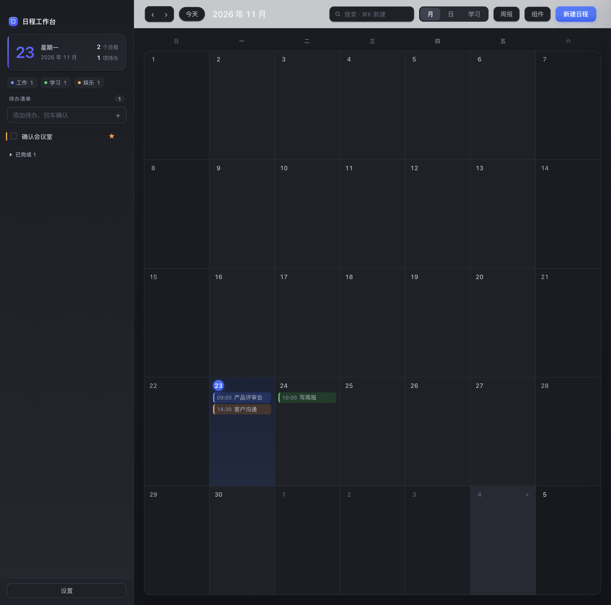
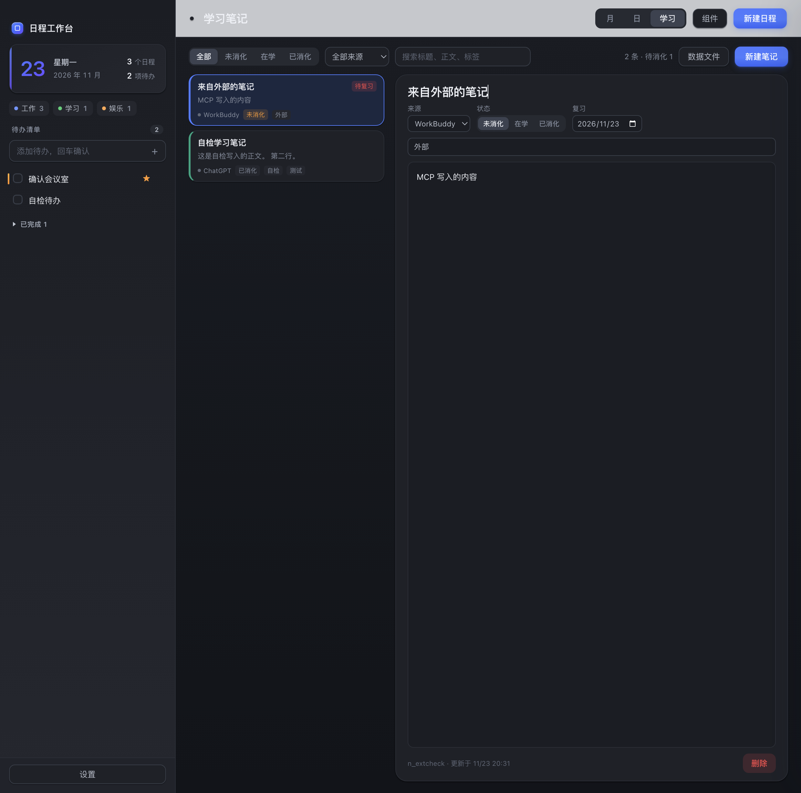

# 日程工作台

一个跑在自己 Mac 上的本地日程工作台。日程、待办、学习笔记都存在本机，不注册、不联网、不上传。



## 功能

- **月 / 日双视图**：月历格子按剩余空间自动决定显示几条，不会把内容挤掉；日视图按时段铺开，可拖动改时间。
- **待办清单**：带重点标记，可折叠已完成。
- **提醒通知**：日程到点弹 macOS 系统通知，点通知直接跳到那一天。
- **重复日程**：每天 / 每个工作日 / 每周 / 每月，可设定重复截止日，支持只改单次或改整个系列。
- **自然语言快速添加**：`⌘K` 输入「明天下午3点 产品评审」直接建日程。
- **周报整理**：按 ISO 周汇总日程与待办，生成 Markdown 正文，可手改、复制、导出 `.md`。
- **学习笔记**：按来源（ChatGPT / WorkBuddy / 书 / 视频 / 课程）和消化状态管理，带复习日期，到期提醒。
- **桌面贴**：置顶小卡片，显示今日日程与待办，可直接勾选完成，透明度可调；外观跟随系统深色模式。
- **撤销与备份**：`⌘Z` 撤销最近 30 步；每天自动备份，保留 14 天。



## 系统要求

- macOS 12 或更高
- **Apple Silicon（M1 及以后）**。当前构建是 arm64，Intel Mac 无法运行。

## 安装

1. 到 [Releases](../../releases) 下载最新的 `日程工作台-mac.zip`，解压。
2. 把「日程工作台.app」拖进「应用程序」文件夹。
3. 第一次打开会被系统拦下，提示「无法验证开发者」——这是正常的，因为安装包没有 Apple 开发者签名。**在图标上右键（或按住 Control 点）→ 打开**，弹窗里再点一次「打开」。之后就能正常双击了。

   如果提示「已损坏」，在终端执行一次：

   ```bash
   xattr -dr com.apple.quarantine /Applications/日程工作台.app
   ```

4. 首次运行时系统会询问是否允许通知，选「允许」，否则到点提醒不会出现。

## 从源码构建

```bash
npm install
./build.sh          # 产物在 build/日程工作台.app
```

打包脚本会复制 Electron 运行时、写入应用代码、安装图标、改 Info.plist、做 ad-hoc 签名。

自检（使用临时数据目录，不碰正式数据）：

```bash
./node_modules/electron/dist/Electron.app/Contents/MacOS/Electron . --smoke --shot --theme=light --no-sandbox
```

## 数据在哪

| 内容 | 路径 |
| --- | --- |
| 日程与待办 | `~/Library/Application Support/ScheduleWorkbench/data.json` |
| 学习笔记 | `~/Library/Application Support/ScheduleWorkbench/study.json` |
| 每日备份 | `~/Library/Application Support/ScheduleWorkbench/backups/` |

设置面板里有「在访达中显示」和导出 JSON / `.ics` 的入口。这两个文件都是纯 JSON，可以直接备份或手工编辑。

## 学习笔记直连（MCP，可选）

`mcp/study-mcp` 是一个零依赖的 MCP 服务，读写的就是上面那个 `study.json`，接给支持 MCP 的客户端之后，可以直接让助手往里写学习记录、或读出你记过什么。

在客户端的 MCP 配置里加：

```json
{
  "mcpServers": {
    "schedule-study": {
      "command": "/Applications/日程工作台.app/Contents/Resources/app/mcp/study-mcp",
      "args": []
    }
  }
}
```

提供 `study_list` / `study_get` / `study_add` / `study_update` / `study_delete` / `study_stats` 六个工具。

## 快捷键

| 快捷键 | 作用 |
| --- | --- |
| `⌘K` | 快速添加（自然语言） |
| `⌘N` | 新建日程 |
| `⌘F` | 搜索 |
| `⌘Z` | 撤销 |
| `⌘T` | 回到今天 |
| `⌘⇧D` | 显示 / 收起桌面贴 |
| `1` `2` `3` | 切换月 / 日 / 学习视图 |

## 已知限制

- 安装包未用 Apple Developer ID 签名、未公证，首次打开需要手动放行（见安装第 3 步）。
- 当前只有 arm64 构建。
- 数据只在本机，多设备之间不自动同步。
